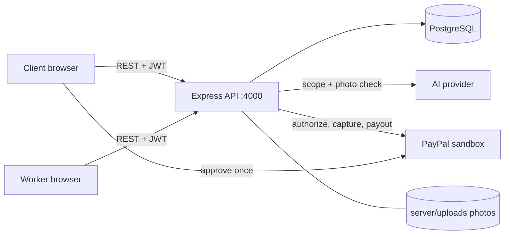

# Kazi-proof

**Pay for physical work only when the proof is there.**

Kazi-proof is a milestone-based escrow platform for physical work such as carpentry, construction, repairs and crafts. A client describes a job, an AI splits it into payment milestones, the client funds it once through PayPal, and each milestone is paid out only after the worker submits photo proof and the client approves it.

> Status: hackathon project, running on the **PayPal sandbox** (test money only).

---

## Table of contents

1. [The problem](#1-the-problem)
2. [The solution](#2-the-solution)
3. [How it works](#3-how-it-works)
4. [Where AI is used (and where it is not)](#4-where-ai-is-used-and-where-it-is-not)
5. [How the money moves](#5-how-the-money-moves)
6. [Trust and safety design](#6-trust-and-safety-design)
7. [Tech stack and architecture](#7-tech-stack-and-architecture)
8. [Getting started](#8-getting-started)
9. [Using the app](#9-using-the-app)
10. [Project structure](#10-project-structure)
11. [API reference](#11-api-reference)
12. [What is built and what is planned](#12-what-is-built-and-what-is-planned)
13. [Known limitations](#13-known-limitations)
14. [Troubleshooting](#14-troubleshooting)
15. [Team and license](#15-team-and-license)

---

## 1. The problem

Paying for physical work from a distance is a trust problem on both sides.

- **Clients** (for example someone abroad paying for work back home, or a school paying a contractor) worry about paying upfront and getting nothing, or paying in full for half-finished work.
- **Workers** (carpenters, builders, craftspeople) worry about doing the work and then not being paid.
- Splitting a job into fair stages and judging whether a stage is really done is slow, awkward and easy to dispute.

## 2. The solution

Kazi-proof puts a neutral process between the two sides:

1. The job is split into **small, checkable milestones**, each with a plain description of what must be visible in a photo.
2. The client funds the **whole job once**. The money is authorized, not sent to the worker.
3. The worker finishes a milestone and submits a **photo as proof**, with time and location attached.
4. Automatic checks and an AI review flag anything suspicious, but **the client decides**.
5. Approving a milestone releases **only that milestone's payment** to the worker.

Neither side has to trust the other. They only have to trust the process.

## 3. How it works

### The journey

| Step | Who | What happens |
|---|---|---|
| 1 | Client | Describes the job in plain words and sets a budget |
| 2 | AI | Proposes 2 to 4 milestones with amounts and photo-proof criteria |
| 3 | Client | Creates the job and approves one PayPal authorization for the total |
| 4 | Worker | Starts milestone 1 once the job is funded |
| 5 | Worker | Uploads a photo of the finished milestone |
| 6 | System | Checks photo age, location and (with AI) whether it matches the criteria |
| 7 | Client | Reviews the photo, the AI verdict and any flags, then approves or disputes |
| 8 | System | On approval, captures that milestone's amount and pays the worker |
| 9 | Both | Repeat 4 to 8 for every milestone. After the last one, the job is complete |

### Milestone states

```
PLANNED -> ACTIVE -> SUBMITTED -> UNDER_REVIEW or FLAGGED -> APPROVED -> RELEASED
                                                          \-> DISPUTED -> ACTIVE (worker restarts)
```

- `UNDER_REVIEW`: the photo passed all automatic checks.
- `FLAGGED`: at least one check failed. The client can still approve it.
- `DISPUTED`: the client rejected the evidence. The worker restarts the step and submits new proof.
- `RELEASED`: money captured and payout sent. Final.

Illegal moves (for example jumping from `PLANNED` to `RELEASED`) are rejected by a single state machine in `server/src/stateMachine.ts`.

## 4. Where AI is used (and where it is not)

AI helps in two places, and in both it is **advisory**.

### 4.1 Job scoping (text)
The client's description goes to the model, which returns 2 to 4 milestones with amounts and photo criteria.

Guardrails, enforced in code and not left to the model:
- The output must match a strict schema (validated with `zod`).
- Amounts are reconciled in cents so they add up **exactly** to the client's budget.
- No single milestone may exceed 50% of the total.
- The job description is treated as untrusted text. Instructions inside it are ignored.
- The endpoint only previews. Nothing is saved and no money moves.

### 4.2 Photo verification (image)
When the worker submits a photo, the model compares it with the milestone's criteria and returns:
- a verdict: `MATCH`, `PARTIAL` or `NO_MATCH`,
- a confidence from 0 to 1,
- a one or two sentence reason.

Only `NO_MATCH` adds a flag (`AI_NO_MATCH`), which moves the milestone to `FLAGGED`. The result is stored with the submission, so the client still sees it after a page reload.

### 4.3 What AI never does
- It **never approves, rejects or pays** anything. Money moves only when the client approves.
- If the AI service is down, slow or returns something unusable, the check is skipped and the submission still goes through for manual review (it fails open to a human, not to a payment).
- The AI provider is swappable with one environment variable (`AI_PROVIDER=gemini` or `anthropic`). All model calls live in one file, `server/src/ai.ts`, which also retries briefly when the provider returns 503 or 429.

## 5. How the money moves

Kazi-proof uses the PayPal sandbox.

1. **Authorize once.** The client approves a single PayPal authorization for the job total. No money goes to the worker yet.
2. **Partial capture per milestone.** When the client approves milestone N, the server captures only that milestone's amount from the authorization.
3. **Payout.** The worker is paid out from the platform account through the PayPal Payouts API.
4. **Idempotent and retryable.** If PayPal fails after an approval, the milestone stays `APPROVED` and the client can retry with a **Retry payment** button. Capture and payout are idempotent, so retrying never pays twice.
5. **Funding check.** Approving a milestone on a job with no PayPal authorization is refused up front.

In the sandbox, payouts can be redirected to a test account with the `PAYOUT_RECEIVER_EMAIL` variable.

## 6. Trust and safety design

| Risk | What the system does |
|---|---|
| Client pays and gets nothing | The money is held as an authorization and only released milestone by milestone |
| Worker is not paid | Each approved milestone is paid out as soon as the client approves it |
| Stale or reused photo | `STALE_PHOTO` flag if the photo is older than 24 hours |
| Photo time in the future | `FUTURE_TIMESTAMP` flag |
| Worker not at the site | `NO_LOCATION` and `LOCATION_FAR` flags (200 m radius when the job has a site) |
| Photo does not show the work | AI check and `AI_NO_MATCH` flag |
| AI is wrong | The client always has the final say, including approving a flagged milestone |
| Illegal status jumps | A single state machine allows only the legal transitions |
| Double payment | Idempotent capture and payout, and the status is changed only through the state machine |
| Prompt injection in job text or photos | Inputs are marked untrusted in the prompts, and outputs are schema-validated |
| Someone viewing another user's job or photos | Every job, milestone and photo route is limited to that job's client and worker |
| Secrets in git | `.env`, `.env.*` and `server/uploads/` are git-ignored |

## 7. Tech stack and architecture

| Layer | Technology |
|---|---|
| Frontend | React, TypeScript, Vite, Tailwind CSS v4, React Router |
| Backend | Node.js, Express, TypeScript (run with `tsx`) |
| Database | PostgreSQL with Prisma |
| Payments | PayPal sandbox (Orders with authorization, partial captures, Payouts) |
| AI | Gemini or Anthropic, selected by environment variable |
| Validation | `zod` |
| Auth | JWT bearer tokens, two roles (`CLIENT`, `WORKER`) |



## 8. Getting started

### Prerequisites
- Node.js 20 or newer and npm
- Docker (for PostgreSQL) or a PostgreSQL database you already have
- A PayPal developer account with sandbox **Business** and **Personal** accounts
- An API key for Gemini or Anthropic

### 8.1 Install

```bash
git clone <your-repo-url> Kazi-proof
cd Kazi-proof
(cd server && npm install)
(cd web && npm install)
```

### 8.2 Configure
Create a `.env` file in the **project root** (the backend loads `../.env`). Never commit it.

| Variable | Purpose |
|---|---|
| `DATABASE_URL` | PostgreSQL connection string |
| `AI_PROVIDER` | `gemini` or `anthropic` |
| `AI_API_KEY` | Key for the chosen provider |
| `AI_MODEL` | Model id from your provider, for example `gemini-3.6-flash` |
| `PAYOUT_RECEIVER_EMAIL` | Optional. Sends sandbox payouts to this test account |
| PayPal sandbox credentials | Client id and secret of your sandbox app. See `server/src/env.ts` for the exact names |
| JWT secret | Signing key for login tokens. See `server/src/env.ts` for the exact name |

To list the variable names your `.env` already has, without printing any values:

```bash
sed 's/=.*//' .env
```

### 8.3 Database

```bash
docker compose up -d
cd server
npx prisma migrate deploy
npx tsx --env-file=../.env src/seed.ts
```

The seed script creates the two demo accounts below.

### 8.4 Run

Terminal 1, the API on port 4000:

```bash
cd server
npm run dev
```

Terminal 2, the web app on port 5173:

```bash
cd web
npm run dev
```

Open <http://localhost:5173>.

### 8.5 Demo accounts

| Role | Email | Password |
|---|---|---|
| Client (Amina) | `client@kazi.demo` | `demo1234` |
| Worker (Juma, carpenter in Nairobi) | `worker@kazi.demo` | `demo1234` |

For the PayPal approval step, use the **Personal** sandbox account from your PayPal developer dashboard (Testing tools, then Sandbox accounts). It is a fake buyer, and no real money is involved.

### 8.6 Deploy to Render

The repository includes a Render Blueprint in [`render.yaml`](render.yaml). It deploys the React app and API together as one web service, plus a PostgreSQL database.

1. Push the repository to GitHub.
2. In Render, choose **New → Blueprint**, connect the repository, and apply the `render.yaml` blueprint.
3. In the `kazi-proof` service's **Environment** settings, add:
   - `PAYPAL_CLIENT_ID` and `PAYPAL_CLIENT_SECRET` from your PayPal **sandbox** app.
   - `AI_API_KEY` from your Gemini account. Change `AI_PROVIDER` and `AI_MODEL` if using a different supported provider.
   - `CLOUDINARY_CLOUD_NAME`, `CLOUDINARY_API_KEY`, and `CLOUDINARY_API_SECRET` from your Cloudinary dashboard to keep uploaded proof photos across restarts. Keep the API secret private.
4. Wait for the service to deploy. Render runs Prisma migrations on service startup.
5. Open the service's `onrender.com` URL. Check `<your-service-url>/api/health`; the response should show `"ok": true` and `"db": true`.
6. To create the demo users, open the service's **Shell** and run `npm run seed` from the `server` directory.

The Blueprint uses free plans for a demo. With Cloudinary configured, proof photos are stored remotely instead of on Render's ephemeral filesystem. Without Cloudinary, the app falls back to local uploads, which can disappear when the service restarts or redeploys. Cloudinary usage is subject to your account's current storage and bandwidth limits. Free PostgreSQL availability and retention are limited; check Render's current plan terms before relying on it.

PayPal stays in sandbox mode with this configuration. The known demo login credentials are public in this README; use them only for a test deployment and do not reuse passwords or credentials from other systems.

## 9. Using the app

**As the client**
1. Sign in as `client@kazi.demo`.
2. Click **+ New job**, describe the work and set a small budget (10 USD is enough for a test).
3. Click **Preview payment plan** to see the AI's milestones. Regenerate if you want a different split.
4. Click **Create job and pay with PayPal**. Log in with the sandbox Personal account and approve.
5. You are sent back to the app with "Funded. The worker can now start."

**As the worker**
1. Sign in as `worker@kazi.demo` and open the funded job.
2. Click **Start this step** on the first milestone.
3. Choose a photo that matches the "Proof needed" text and click **Submit photo proof**. Allow location if the browser asks.

**Back as the client**
1. Open the job. You see the photo, the AI verdict with its confidence, and any flags.
2. Click **Approve and pay**, or **Dispute** if the proof is not good enough.
3. After approval the card shows the payment status, ending at `PAYOUT_SENT`.
4. Repeat for the remaining milestones. When the last one is released, the job shows `COMPLETED`.

## 10. Project structure

```
Kazi-proof/
├── README.md
├── docker-compose.yml
├── docs/
│   └── API.md              Full API reference
├── server/
│   ├── prisma/             Schema and migrations
│   ├── scripts/            Small test scripts (AI check, force-fund)
│   ├── uploads/            Submitted photos (git-ignored)
│   └── src/
│       ├── index.ts        Express app and route wiring
│       ├── auth.ts         Login and role-based access
│       ├── jobs.ts         Create, list, fund, confirm funding, scope
│       ├── milestones.ts   Start, submit, approve, release, dispute, photo
│       ├── stateMachine.ts The only legal milestone transitions
│       ├── scoping.ts      AI job scoping and amount reconciliation
│       ├── verify.ts       AI photo check against the criteria
│       ├── ai.ts           The only file that talks to the AI provider
│       ├── paypal.ts       Orders, partial captures and payouts
│       ├── db.ts           Prisma client
│       ├── env.ts          Environment loading
│       └── seed.ts         Demo users
├── spike/                  Early PayPal sandbox experiments
└── web/
    └── src/
        ├── api.ts          Session storage and the request helper
        ├── pages/          Login, Jobs, NewJob, JobDetail, PaypalReturn
        └── components/     MilestoneCard (worker upload, client review)
```

## 11. API reference

The complete reference, with request and response examples, status codes and the happy path, is in [`docs/API.md`](docs/API.md).

Summary:

| Area | Routes |
|---|---|
| Auth | `POST /api/auth/login` |
| Jobs | `POST /api/jobs/scope`, `POST /api/jobs`, `GET /api/jobs`, `GET /api/jobs/:id`, `POST /api/jobs/:id/fund`, `POST /api/jobs/:id/confirm-funding` |
| Milestones | `POST /api/milestones/:id/start`, `.../submit`, `.../approve`, `.../release`, `.../dispute`, `GET /api/milestones/:id`, `GET /api/milestones/:id/photo` |

## 12. What is built and what is planned

### Built and tested
- [x] Login with two roles
- [x] AI job scoping with exact amount reconciliation
- [x] Job creation with milestones
- [x] PayPal authorization through the browser, then confirmation
- [x] Worker flow: start a milestone, upload a photo (resized in the browser)
- [x] Automatic photo checks: age, future time, location, distance to the site
- [x] AI photo verification, stored with the submission
- [x] Client review: photo, AI verdict, flags, approve or dispute
- [x] Partial capture and payout per milestone, with retry
- [x] Job completion and a reputation event for the worker
- [x] Authenticated photo route
- [x] Full flow tested end to end on the PayPal sandbox

### Planned (not built)
- [ ] **Photo authenticity checks.** Perceptual hashing (`phash`) to catch reused or stock photos, and EXIF checks. The database columns exist, but nothing fills them yet.
- [ ] Worker reputation shown in the app. Events are recorded, but there is no screen or route to view them.
- [ ] Auto-approval below a client-set limit (`autoApproveLimit` is stored but unused).
- [ ] Challenge codes for live proof (`challengeCode` is stored but unused).
- [ ] Real payments and local payout methods (for example mobile money). Today it is PayPal sandbox only.
- [ ] Notifications (email or SMS) when proof is submitted or a payment is released.
- [ ] Automated tests and a deployed demo.

## 13. Known limitations

- **Sandbox only.** No real money moves.
- **Photos can still be faked.** The AI judges what a photo shows, not where it came from. A convincing stock photo that passes the checks can still reach the client, which is why the client always decides and why the planned `phash` and EXIF checks matter.
- **Browser time.** The photo time comes from the file's last-modified time, which a worker could change. Server-side metadata checks are planned.
- **Single payout path.** Payouts go through PayPal and need the worker's PayPal email.
- **Currency.** Jobs are created in USD by default.
- **Budget cap.** The AI scoping endpoint accepts totals up to 5000.
- **Local file storage.** Photos are saved on the server's disk under `server/uploads/`.

## 14. Troubleshooting

| Symptom | Cause and fix |
|---|---|
| AI call hangs or uses an old model | A shell variable overrides `.env`. Run `unset AI_API_KEY AI_PROVIDER AI_MODEL` and restart the server. Do not `source .env` before starting it |
| `503` from the AI provider | Provider overload. The server retries up to 3 times. If it persists, set a different `AI_MODEL` and restart |
| PayPal sandbox connection times out | The dev script forces IPv4 first. Try a different network (a phone hotspot) |
| `Job has no PayPal authorization (not funded)` | The job was never funded through PayPal. Fund it from the app with **Pay with PayPal** |
| Photo shows nothing in the browser | The photo route needs the auth header, so the app fetches it as a blob. A plain `` to the API does not work |
| Submit button stays disabled | Choose a photo file first. Allow location if you want to avoid the `NO_LOCATION` flag |
| Terminal prints garbage after a paste | Copy only the code inside the block, not lines that start with a prompt like `user@host:~$` |

## 15. Team and license

- Team: hackathon team of three. Add names and roles here.
- License: see [`LICENSE`](LICENSE).
